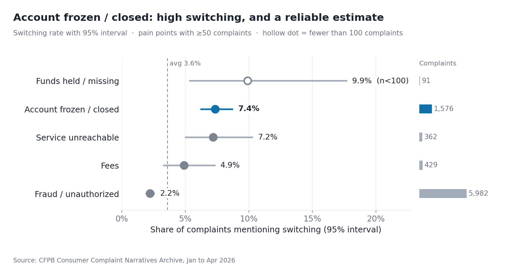
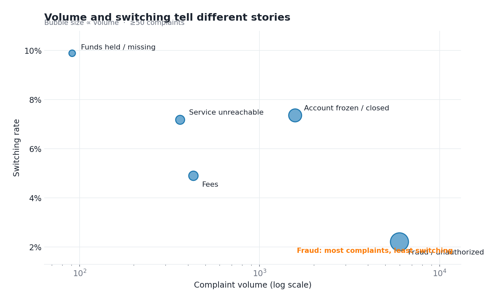
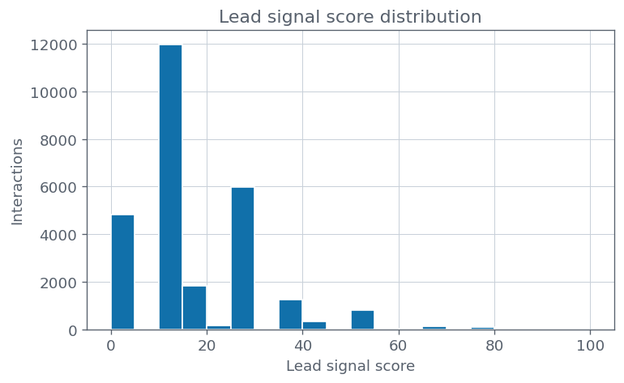
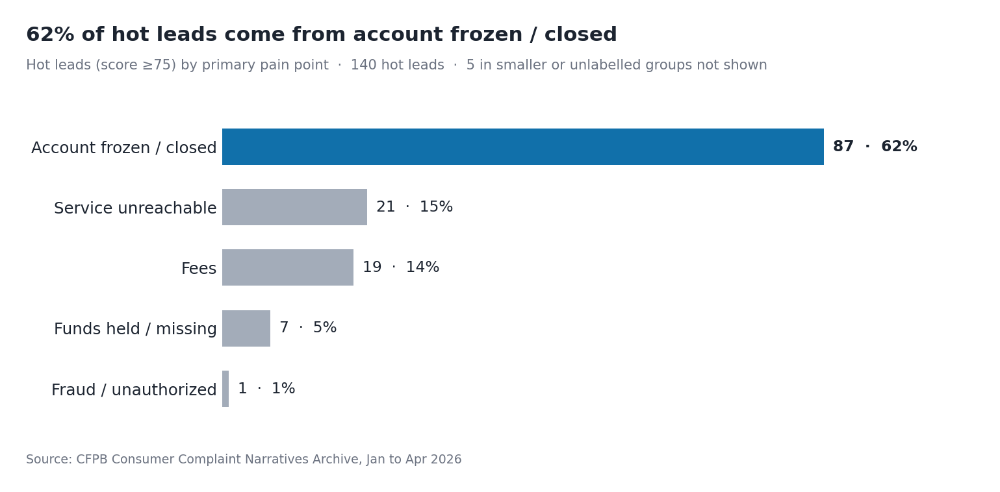

### Fintech text to table

##### Paul Taiwo-Adeyemo

CFPB complaint narratives turned into one table you can query. Each row is an interaction with a pain point, switching flag, dollar amount, delay, severity, and a lead-signal score. The rules that fired are stored so you can see where a value came from.

The question is which pain points make people want to switch, and which rows look like the strongest acquisition signals.

### Results

From **27,991** narratives (Jan–Apr 2026). Charts in `results/figures/`.

**1. Where switching intent shows up**



**2. Volume ≠ switching** — fraud dominates complaints; other pain points switch more



**3. Acquisition funnel** — a small slice scores as hot leads



**4. Where to look first** — hot leads by pain point



Interactive leads table: [`results/figures/top_lead_signals.html`](results/figures/top_lead_signals.html).

SQLite + full CSV are built locally (not in git): `results/signals.db`, `results/exports/fct_interaction.csv`.

### Layout

```text
config/         scoring.yaml + lexicons
src/pipeline/   ingest → clean → extract → score → load → quality
src/            build, insights, evaluate, viz
sql/            DDL + analysis queries
docs/           architecture, scoring, data dictionary, how to run
results/        figures (shared); db + exports (local after build)
notebooks/      run_pipeline (build) + demo (explore)
```

### Data

As of September 2026, the live [Consumer Complaint Database](https://www.consumerfinance.gov/data-research/consumer-complaints/) no longer ships complaint narratives ([release notes](https://cfpb.github.io/api/ccdb/release-notes.html)). Narratives come from the [CFPB Narratives Archive](https://www.consumerfinance.gov/foia-requests/foia-electronic-reading-room/cfpb-consumer-complaint-database-narratives-archive/).

**Source files used here (Full Records):**

- CCDB Export January 2026 through February 2026
- CCDB Export March 2026
- CCDB Export April 2026

**Filters applied for this project:**

- Date received: **2026-01-01 to 2026-04-30**
- Checking or savings account → Checking account, Savings account
- Credit card → General-purpose credit card or charge card
- Money transfer, virtual currency, or money service → Mobile or digital wallet; Domestic (US) money transfer; International money transfer; Money order, traveler's check or cashier's check; Check cashing service
- Non-empty **Consumer complaint narrative** only

Raw data is not in git (`data/raw/` is ignored). Pipeline cap is 100,000 (`config/scoring.yaml` → `ingest.max_rows`).

Flow: `docs/architecture.md`. Run guide: `docs/how_to_run.md`. Scoring: `docs/scoring.md`. Columns: `docs/data_dictionary.md`.

### How to run

Full steps: **`docs/how_to_run.md`**.

```bash
git clone https://github.com/paultaiwo-a/fintech-text-to-table.git
cd fintech-text-to-table
python3 -m venv .venv && source .venv/bin/activate
pip install -r requirements.txt

mkdir -p data/raw
cp /path/to/your-export.csv data/raw/complaints.csv
python -m src.build

# or another file
python -m src.build --csv /path/to/another-export.csv
```

Optional notebooks: `notebooks/run_pipeline.ipynb` (build from a CSV) or `notebooks/demo.ipynb` (explore results).
